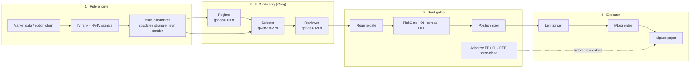

# VoltAgent

Autonomous **volatility options** trading agent for the [Alpaca AI Trading Agents Hackathon](https://lablab.ai/ai-hackathons/alpaca-ai-trading-agents-hackathon).

**Rule signals → LLM advisory → hard risk gates → Alpaca MLeg execution.**  
The model can advise. Deterministic Python authorizes and trades.

| | |
|--|--|
| Broker | Alpaca paper (`alpaca-py`), Options Level 3 |
| AI | Groq `qwen/qwen3.8-27b` + `openai/gpt-oss-120b` |
| Strategies | Long straddle, strangle, iron condor |
| Clock | `America/New_York` market-hours daemon |

Hackathon write-up: [`SUBMISSION.md`](SUBMISSION.md)

---

## Architecture



### What each layer may do

| Layer | Allowed | Forbidden |
|-------|---------|-----------|
| **Rule** | Score IV, pick ATM/OTM legs, DTE 14–35 | — |
| **LLM** | Classify regime; pick among **named** strategies; approve / hold | Invent strikes, change qty, skip risk |
| **Gate** | Reject daily loss, max underlyings, duplicates, liquidity | Overridden by LLM |
| **Executor** | Price debit/credit + slippage; submit MLeg limit | Trade without a passed gate |

Every intraday cycle runs **exit checks first**, then entry scan.

---

## Quick start

```bash
python -m venv .venv && source .venv/bin/activate
pip install -r requirements.txt
cp .env.example .env   # fill ALPACA_* and GROQ_API_KEY
```

```bash
# health check
PYTHONPATH=. python scripts/run_agent.py --mode health

# dry-run one intraday cycle (no orders)
PYTHONPATH=. python scripts/run_agent.py --mode once --phase intraday

# paper live — market-hours daemon
./scripts/start_agent.sh

# account / positions / local trade log
PYTHONPATH=. python scripts/check_orders.py
```

Daemon schedule (Eastern Time):

| Time | Action |
|------|--------|
| 09:25 | Premarket regime |
| 09:25–15:30 | Exit + entry every 30 min |
| 15:50 | Postmarket metrics |
| After close / weekends | Sleep until next weekday 09:25 ET |

---

## Risk defaults

See `.env.example`. Highlights:

- `MAX_RISK_PER_TRADE=0.02`, `MAX_DAILY_LOSS=0.03`, `MAX_POSITIONS=5` (by underlying)
- Skip symbols with open positions or working orders
- Adaptive exits: TP/SL widen with DTE; force close at `EXIT_FORCE_DTE=7`

Decision audit prefixes in `logs/agent.log`: `[AI:regime]`, `[AI:selector]`, `[AI:reviewer]`, `[DECISION]`, `[EXIT]`.

---

## Repo layout

```
config/          settings + model routing
core/            agent orchestrator, NY-session daemon, SQLite state
data/            Alpaca clients, bars, chains, OCC, quotes
signals/         volatility signals
strategies/      iron_condor · straddle · strangle
risk/            gates, regime gate, sizer, exit rules
llm/             Groq client + regime / selector / reviewer
execution/       MLeg builder, pricer, exit manager
observability/   logs + metrics
scripts/         run_agent, check_orders, start_agent.sh
mcp/             Alpaca MCP notes (dev / demo)
tests/
```

Runtime uses the **SDK**. MCP is for development inspection of the same paper account (`mcp/README.md`).

---

## Safety

- Never commit `.env`. Paper mode: `ALPACA_PAPER=true`.
- This is research / hackathon software — not investment advice.
- Live trading would reuse the same gates; paper is the supported path here.

## License

MIT (hackathon submission).
